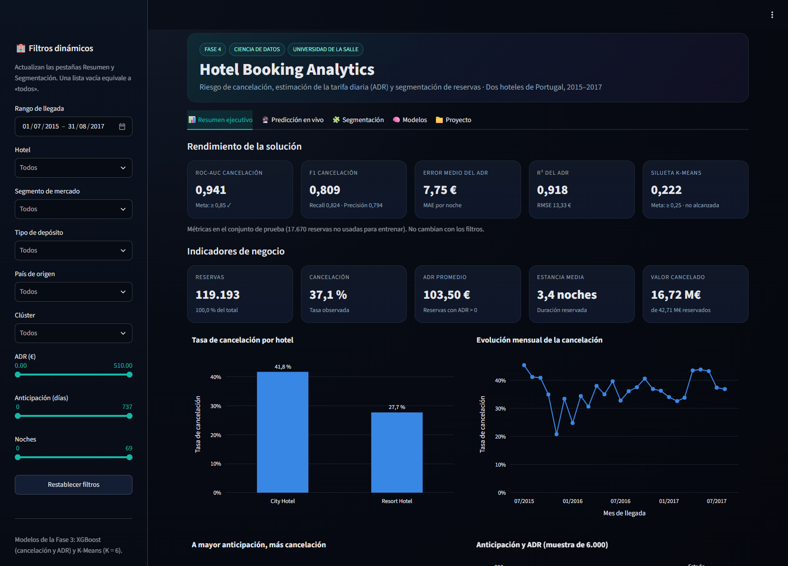

# Hotel Booking Analytics

Proyecto Integrador de Ciencia de Datos · Maestría en Inteligencia Artificial · Universidad de La Salle

**Autores:** [Miguel Angel Ricardo](https://github.com/Miguel0819R) y [Jose Alexander Barahona Calderon](https://github.com/AlexBarahonaC)  
**Docente:** Fabián Camilo Castro Riveros

- **Dashboard en vivo:** _pendiente: pegar URL de Streamlit_
- **Repositorio:** https://github.com/AlexBarahonaC/hotel-booking-analytics

Predice la cancelación de reservas hoteleras, estima su tarifa diaria (ADR) y las segmenta por perfil de riesgo y valor, a partir de 119.193 reservas de dos hoteles de Portugal (2015–2017).



## Ejecución

Requiere **Python 3.13 o 3.12 de 64 bits**. Python 3.14 no sirve, porque scikit-learn 1.6.1 no lo soporta.

**Windows:** doble clic en `EJECUTAR_DASHBOARD.bat`.

**Manual:**

```bash
python -m venv .venv
.venv\Scripts\activate          # Linux/macOS: source .venv/bin/activate
python -m pip install -r requirements.txt
python src/smoke_test.py
python -m streamlit run dashboard/app.py
```

## Módulos del dashboard

| Requisito de la guía | Implementación |
|---|---|
| Filtros dinámicos | Fecha de llegada, hotel, segmento, depósito, país, clúster, ADR, anticipación y noches. Actualizan Resumen y Segmentación |
| Tarjetas KPI | Rendimiento de la solución (ROC-AUC, F1, MAE, R², silueta) e indicadores de negocio |
| Predicción en vivo | Un formulario devuelve riesgo de cancelación, ADR estimado, segmento y factores que explican cada resultado |
| Segmentación | Mapa en espacio PCA, 2D o 3D, con resaltado de clústeres, y perfiles promedio |

## Resultados en el conjunto de prueba

| Tarea | Modelo | Métricas |
|---|---|---|
| Cancelación | XGBoost (umbral 0,568) | ROC-AUC 0,941 · F1 0,809 · Precision 0,794 · Recall 0,824 |
| ADR | XGBoost | MAE 7,75 € · RMSE 13,33 € · R² 0,918 |
| Segmentación | K-Means, K = 6 | Silueta 0,220 (train) y 0,222 (prueba) |

Proceden del cuaderno `notebooks/Fase3_ModeladoAvanzado_Colab.ipynb` (ejecución del 23 de noviembre de 2026).

**Límites.** Al entrenar con 2015–2016 y evaluar en 2017, el ROC-AUC baja a 0,881 y el R² a 0,756. El modelo depende de `country` (−0,046 de ROC-AUC sin ella). El puntaje de cancelación ordena el riesgo, pero no es una probabilidad calibrada.

## Estructura

```text
├── data/            Particiones depuradas (train, val, test)
├── notebooks/       Cuadernos de las Fases 1, 2 y 3
├── src/             Transformadores, datos, modelos, exportación y prueba de integridad
├── dashboard/       Aplicación Streamlit
├── models/          Modelos portables, métricas y metadatos
├── figures/         Figuras de la Fase 3
├── docs/            Informes, capturas, guía de publicación y guion de sustentación
├── requirements.txt             Dependencias del dashboard
└── requirements-notebooks.txt   Dependencias de los cuadernos
```

## Reproducibilidad

- `src/smoke_test.py` comprueba que los modelos reproducen ROC-AUC, F1 y MAE oficiales, que los clústeres coinciden con los de la Fase 3 y que la semana de llegada se calcula como en el dataset.
- `src/exportar_modelos_nativos.py` documenta cómo se obtuvieron los modelos portables a partir de los `.joblib` de Colab, sin reentrenar.
- Los cuadernos se ejecutaron en Google Colab. El de la Fase 3 lee los CSV desde su directorio de trabajo: copia allí los archivos de `data/`.

## Datos

Antonio, N., Almeida, A. y Nunes, L. (2019). Hotel booking demand datasets. *Data in Brief*, 22, 41–49. https://doi.org/10.1016/j.dib.2018.11.126. Distribuidos en Kaggle (`jessemostipak/hotel-booking-demand`) con licencia CC BY 4.0. Los archivos de `data/` son una versión depurada por los autores de este proyecto.
